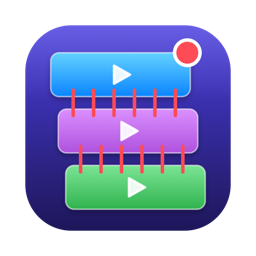
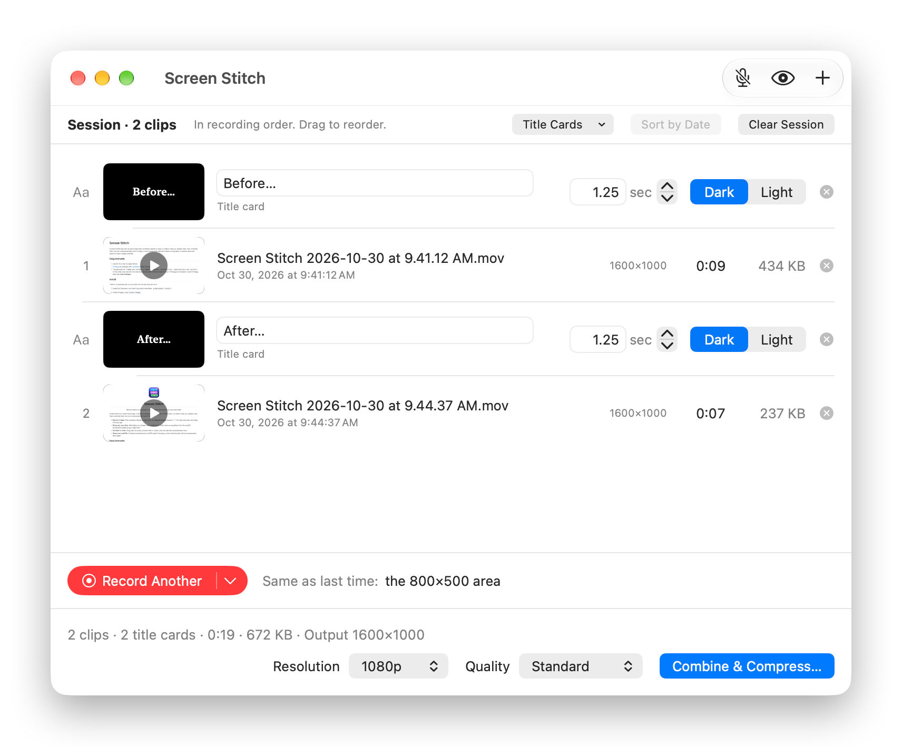

<p align="center">
  
</p>

<h1 align="center">Screen Stitch</h1>

<p align="center">Record a demo or bug report in a few takes, then share it as one small video.</p>

<p align="center">
  
</p>

Screen Stitch is a small macOS app. It records a window, a display or part of the screen, or collects clips you already
have, then combines them into one compressed MP4 with FFmpeg.

- **Record in takes.** Pick a window, display or area once, and **Record Another** reuses it. ⌃⌥R starts and stops
  recording from any app.
- **Bring your own clips.** Add videos you already have, or let Screen Stitch pick up recordings from the macOS
  Screenshot toolbar as you make them.
- **Put them in order.** Drag clips into place, preview them in Quick Look and add title cards between them.
- **Share one small file.** Combine everything into an MP4 sized for sharing, or join matching clips without
  compressing them again.

## Requirements

- macOS 15 or later on Apple Silicon
- [FFmpeg](https://ffmpeg.org), for example from [Homebrew](https://brew.sh): `brew install ffmpeg`
- The Command Line Tools, to build the app: `xcode-select --install`

## Install

There's no download yet, so you build Screen Stitch on the Mac that will run it. In Terminal:

```sh
git clone https://github.com/hobochili/screen-stitch.git
cd screen-stitch
./build.sh --install
```

Then open Screen Stitch from `~/Applications`. The first time you record, it asks for Screen Recording permission: click
**Open System Settings**, turn Screen Stitch on, then click **Quit & Reopen**.

> [!TIP]
> The first time you run `./build.sh --install`, it offers to create a local signing certificate. Say yes. Without one,
> macOS forgets the Screen Recording permission every time you update. See [Signing](docs/development.md#signing).

## Update

```sh
cd screen-stitch
git pull
./build.sh --install
```

This quits Screen Stitch, installs the new version and reopens it. If a dialog or sheet is open, the app can't quit, so
the script gives up after about 10 seconds. Close it and run the command again.

## Quick start

1. Click **Record Screen** and pick a window, a display or **Select Area**.
2. Set up what you're recording, then click **Start** in the floating bar at the top of the screen.
3. Click **Stop** when you're done. The clip is added to the list.
4. Click **Record Another** for the next take, or **Add Videos…** to bring in clips you already have.
5. Drag the clips into order, click **Combine & Compress…** and choose where to save the video.

## Learn more

- **[User guide](docs/guide.md)**: recording, shortcuts, adding and arranging clips, title cards, combining and
  troubleshooting.
- **[How it works](docs/how-it-works.md)**: how clips are ordered, sized and encoded, plus the command line.
- **[Development](docs/development.md)**: building without Xcode, signing and running the tests.

## License

[MIT](LICENSE)
